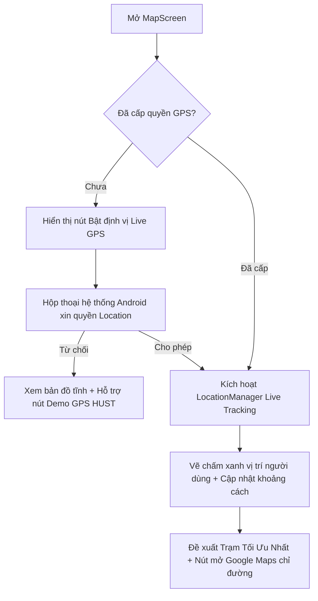

# Kế hoạch Xây dựng & Vận hành: Định vị GPS Live, Tối ưu Trạm gần nhất & Kiểm soát Độ lấp đầy Kho (FLYSTIC)

## 1. Mục tiêu cốt lõi
1. **Live GPS Tracking (Khi người dùng cho phép):** Xin quyền vị trí chuẩn Android (`ACCESS_FINE_LOCATION` / `ACCESS_COARSE_LOCATION`), hiển thị vị trí trực tiếp của sinh viên trên bản đồ khuôn viên ĐHBK Hà Nội (HUST) và tự động ngắt GPS khi rời màn hình để tiết kiệm pin.
2. **Tối ưu đường đi & Gợi ý trạm thông minh:** Kết hợp khoảng cách GPS thực tế và tỷ lệ lấp đầy kho để đề xuất trạm tiếp nhận tối ưu nhất (tránh dẫn sinh viên tới trạm gần nhưng đã đầy 100%), kèm nút mở Google Maps chỉ đường đi bộ.
3. **Kiểm soát độ lấp đầy kho theo thời gian thực:** Theo dõi sức chứa từng trạm (`capacity_kg`), phân loại trạng thái theo 4 mức cảnh báo màu sắc và hỗ trợ Admin dọn kho (`station_transfers`) chỉ với 1 chạm.

---

## 2. Kiến trúc Kỹ thuật & Công thức Tính toán

### 2.1. Kiểm soát độ lấp đầy kho (Capacity & Traffic-Light Protocol)
Dựa trên logic sẵn có trong `FlysticModels.kt`:
$$\text{Filled (kg)} = \max\left(0, \sum \text{Confirmed Transactions (kg)} - \sum \text{Station Transfers (kg)}\right)$$
$$\text{Fill Percent (\%)} = \min\left(100, \text{round}\left(\frac{\text{Filled (kg)}}{\text{Capacity (kg)}} \times 100\right)\right)$$

| Trạng thái | Ngưỡng lấp đầy | Hiển thị UI | Hành động vận hành |
| :--- | :---: | :--- | :--- |
| **Sẵn sàng** | `0% - 60%` | 🟢 Xanh lá | Tiếp nhận bình thường, ưu tiên điều hướng sinh viên tới. |
| **Sắp đầy** | `61% - 85%` | 🟡 Vàng | Nhắc Admin chuẩn bị bao chứa mới. |
| **Quá tải** | `86% - 99%` | 🔴 Đỏ | Cảnh báo điều phối xe thu gom; ưu tiên gợi ý sinh viên sang trạm lân cận. |
| **Tạm đầy** | `100%` | ⚫ Xám | Tạm ngưng tạo QR giao dịch mới cho tới khi Admin bấm xác nhận chuyển kho. |

### 2.2. Tọa độ GPS thực tế của các trạm tại HUST
Bổ sung tọa độ WGS84 chuẩn cho các điểm thu gom hiện có:
- **`soict-b1` (Tòa B1 - Trường CNTT & TT):** `21.0068, 105.8427` (`mapX = 0.65f, mapY = 0.55f`)
- **`chem-life-c3` (Tòa C3 - Trường Hóa & KHSS):** `21.0040, 105.8415` (`mapX = 0.35f, mapY = 0.24f`)
- **`mechanical-c7` (Tòa C7 - Trường Cơ khí):** `21.0051, 105.8433` (`mapX = 0.49f, mapY = 0.35f`)
- **`innovation-center` (Tòa C7 - Trung tâm ĐMST):** `21.0048, 105.8422` (`mapX = 0.19f, mapY = 0.54f`)

### 2.3. Ánh xạ GPS lên Bản đồ Campus (GPS-to-Map Projection)
Sử dụng khung tọa độ ranh giới (Bounding Box) của khuôn viên HUST:
- **Tây Bắc (Top-Left):** `Lat_max = 21.0085`, `Lon_min = 105.8400`
- **Đông Nam (Bottom-Right):** `Lat_min = 21.0020`, `Lon_max = 105.8465`

Khi nhận tọa độ `(userLat, userLon)`:
$$x_{\text{fraction}} = \text{clamp}\left(\frac{\text{userLon} - \text{Lon}_{\min}}{\text{Lon}_{\max} - \text{Lon}_{\min}}, 0.05, 0.95\right), \quad y_{\text{fraction}} = \text{clamp}\left(\frac{\text{Lat}_{\max} - \text{userLat}}{\text{Lat}_{\max} - \text{Lat}_{\min}}, 0.05, 0.95\right)$$

### 2.4. Thuật toán Xếp hạng Trạm Tối ưu (Smart Station Scoring)
1. **Khoảng cách thực tế ($d$):** Tính bằng công thức Haversine (mét) từ vị trí người dùng tới từng trạm.
2. **Điểm ưu tiên ($S$):** Kết hợp 60% trọng số khoảng cách và 40% trọng số sức chứa trống:
   $$S = 0.6 \times \left(1 - \min\left(1, \frac{d}{1000}\right)\right) + 0.4 \times \left(1 - \frac{\text{FillPercent}}{100}\right)$$
   *(Nếu trạm đầy `100%`, tự động xếp cuối danh sách và gắn nhãn khuyến nghị chuyển sang trạm kế bên).*

---

## 3. Luồng Cấp quyền & Trải nghiệm Người dùng (UX Flow)

- **Quản lý vòng đời & Pin:** Đăng ký `LocationListener` (`GPS_PROVIDER` + `NETWORK_PROVIDER`, chu kỳ `3000ms` hoặc `3m`) bên trong `DisposableEffect` của `MapScreen`. Tự động gọi `removeUpdates` ngay khi người dùng rời màn hình Bản đồ.
- **Chế độ Demo tại phòng thi (Simulated Campus GPS):** Cung cấp nút bật/tắt nhanh *"Giả lập vị trí tại sân C7/B1 HUST"* ngay trên `MapScreen` để Ban Giám Khảo trải nghiệm tính năng nhảy khoảng cách và đổi trạm đề xuất ngay tại bàn chấm thi dù đang ở ngoài trường.
- **Điều hướng chỉ đường 1 chạm:** Mỗi thẻ trạm có nút **"Chỉ đường"** kích hoạt Intent `google.navigation:q=<lat>,<lng>&mode=w` (chế độ đi bộ).

---

## 4. Quy trình Vận hành Giải phóng Kho (Station Clearing SOP)
1. **Thu nhận:** Sinh viên mang nhựa tới trạm $\rightarrow$ Admin cân và tạo QR giao dịch $\rightarrow$ Sinh viên quét mã xác nhận $\rightarrow$ `% lấp đầy` của trạm tự động tăng lên.
2. **Cảnh báo:** Khi trạm vượt ngưỡng `85%`, thẻ trạm chuyển màu đỏ trên cả màn hình Sinh viên và Admin Dashboard.
3. **Giải phóng kho:** Đội thu gom vận chuyển nhựa về kho tổng $\rightarrow$ Admin vào `AdminReportsScreen` bấm **"Ghi nhận chuyển kho"** (`recordTransfer`) $\rightarrow$ Độ lấp đầy lập tức reset về mức `0%`, trạm mở lại trạng thái Xanh lá.

---

## 5. Checklist Các File Cần Cập nhật

| Thứ tự | File mục tiêu | Nội dung chỉnh sửa cụ thể |
| :---: | :--- | :--- |
| **1** | `app/src/main/AndroidManifest.xml` | Thêm quyền `ACCESS_COARSE_LOCATION` và `ACCESS_FINE_LOCATION`. |
| **2** | `app/src/main/java/com/verifour/app/model/FlysticModels.kt` | • Thêm `latitude: Double`, `longitude: Double` vào `CollectionPointMeta` và cập nhật cho 4 trạm. • Thêm hàm `calculateDistanceMeters(...)`, `projectGpsToCampusMap(...)` và `rankStationsBySmartScore(...)`. |
| **3** | `app/src/main/java/com/verifour/app/ui/screens/MapScreen.kt` | • Tích hợp `rememberLauncherForActivityResult` xin quyền GPS. • Lắng nghe tọa độ live qua `LocationManager` trong `DisposableEffect`. • Vẽ chấm xanh vị trí người dùng trên bản đồ HUST. • Hiển thị thẻ **Trạm đề xuất tối ưu nhất**, khoảng cách (m), thanh màu độ lấp đầy và nút mở Google Maps. • Thêm nút bật/tắt **Mô phỏng vị trí tại HUST** phục vụ Demo. |
| **4** | `app/src/main/java/com/verifour/app/i18n/FlysticTranslations.kt` | Bổ sung từ khóa đa ngôn ngữ (`VI`, `EN`, `KO`) cho trạng thái GPS, khoảng cách, độ lấp đầy và nút chỉ đường. |
| **5** | `backend/migrations/0005_station_coordinates.sql` & `backend/src/worker.ts` | Cập nhật tọa độ thật cho bảng `stations` trên D1 database để đồng bộ giữa Web/PWA và Android App. |

---

## 6. Kịch bản Demo 90 giây trước Ban Giám Khảo CodeX Hackathon
1. **Đóng hẳn & Mở lại App trên điện thoại thật (15s):** Vuốt tắt hoàn toàn FLYSTIC từ đa nhiệm, mở lại từ màn hình chính.
2. **Bật GPS Live & Tìm trạm tối ưu (30s):** Vào tab **Bản đồ**, bấm **Bật định vị GPS** $\rightarrow$ Chấm xanh vị trí xuất hiện, hệ thống tự động tính khoảng cách tới từng trạm và đẩy **Trạm tối ưu nhất** (gần + còn nhiều chỗ trống) lên đầu danh sách.
3. **Kiểm chứng thay đổi độ lấp đầy trực tiếp (30s):** Tạo/xác nhận 1 giao dịch thu gom nhựa lớn tại trạm gần nhất khiến kho vượt ngưỡng `85%` (chuyển sang màu Đỏ) $\rightarrow$ Hệ thống lập tức đổi khuyến nghị sang trạm kế bên còn trống.
4. **Admin giải phóng kho (15s):** Trên màn hình Admin, bấm **Chuyển kho** $\rightarrow$ Kho về `0%` (Xanh lá) ngay lập tức.

